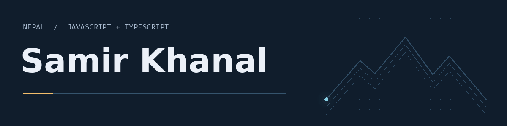
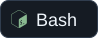
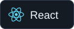
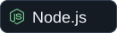

<a href="https://samirkhanal.is-a.dev">
  <picture>
    <source media="(prefers-reduced-motion: reduce) and (prefers-color-scheme: dark)" srcset="assets/hero-dark.png">
    <source media="(prefers-reduced-motion: reduce)" srcset="assets/hero-light.png">
    <source media="(prefers-color-scheme: dark)" srcset="assets/hero-dark.gif">
    <source media="(prefers-color-scheme: light)" srcset="assets/hero-light.gif">
    
  </picture>
</a>

**Software Developer · Computer Science Student · Nepal**

Building scalable web applications with a focus on JS/TS architecture.

 

---

## Stack

**Languages**
    

**Frontend**
   

**Backend**
   

**Databases & BaaS**
    

**AI & agentic tools**
     

**DevOps & Tools**
        

---

## Connect

     

---

*Open to collaborating on interesting web applications.*
