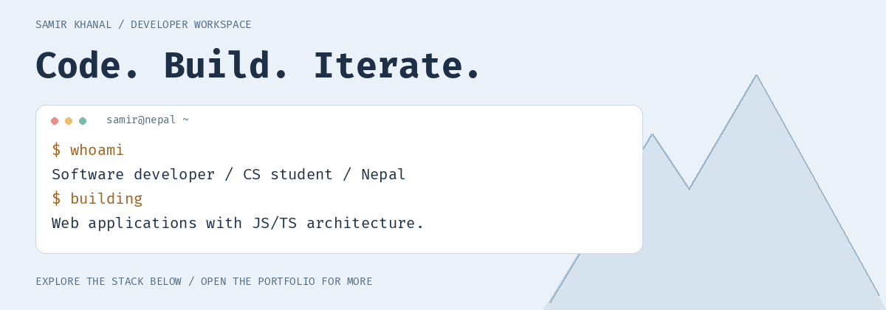

<a href="https://samirkhanal.is-a.dev">
  <picture>
    <source media="(prefers-color-scheme: dark)" srcset="assets/hero-dark.gif">
    <source media="(prefers-color-scheme: light)" srcset="assets/hero-light.gif">
    
  </picture>
</a>

# Hey, I'm Samir

**Software Developer · Computer Science Student · Nepal**

Building scalable web applications with a focus on **JavaScript / TypeScript architecture**.
Open to collaborating on interesting web applications.

**[Explore my portfolio ↗](https://samirkhanal.is-a.dev)** · **[Email me ↗](mailto:khanalsamirwork@gmail.com)** · **[Browse my repositories ↗](https://github.com/khanal-samir?tab=repositories)**

[Selected work](#selected-work) · [AI workspace](#ai-workspace) · [Stack](#stack) · [Writing](#writing) · [Connect](#connect)

<b>Prefer a still banner? Open the motion-free version</b>

<picture>
  <source media="(prefers-color-scheme: dark)" srcset="assets/hero-dark.png">
  
</picture>

The animated banner plays once, then rests. GitHub doesn't provide a README-wide animation toggle.

## Selected work

| Project | Explore |
| :--- | :--- |
| **Typer Durden** — a Monkeytype-inspired typing project | [Source](https://github.com/khanal-samir/Typer-Durden) · [Try it ↗](https://typer-durden.vercel.app) |
| **Snip Snap** — share code in a snap | [Source](https://github.com/khanal-samir/Snip-Snap) · [Open app ↗](https://snip-snap-two.vercel.app) |
| **Student Management System** | [Source](https://github.com/khanal-samir/SMS) · [Open app ↗](https://sms-web.samir.software) |

## AI workspace

*Click a tool to explore it. Expand a category to see the workspace.*

<b>Models & providers · OpenAI / Anthropic</b>

<b>Agentic coding tools · Cursor / OpenCode / Pi</b>

<b>Agent frameworks · Mastra</b>

## Stack

**Core tools**

<b>Languages</b>

<b>Frontend</b>

<b>Backend</b>

<b>Databases & BaaS</b>

<b>Testing · Jest / Vitest</b>

<b>DevOps & tools</b>

## Writing

<!-- BLOG-START -->
- [My Journey Learning Next.js: Building Real Projects](https://dev.to/khanalsamir/my-journey-learning-nextjs-building-real-projects-7c8)

[All posts on dev.to ↗](https://www.dev.to/khanalsamir) · [Hashnode ↗](https://samir-khanal.hashnode.dev)
<!-- BLOG-END -->

## Connect

---

[↑ Back to the workspace](#hey-im-samir)
